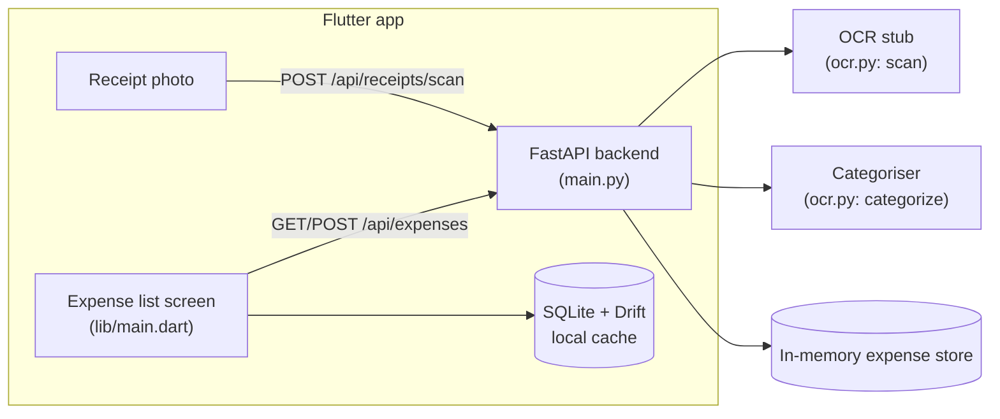

# LedgerLens — Receipt OCR Expense Manager

> A Flutter personal-finance app that scans receipts, extracts amount/merchant/date with on-device OCR, and tracks spending through a FastAPI backend.

[](#testing)
[](./LICENSE)
[](./backend)
[](./backend)
[](./mobile)

## Overview

LedgerLens turns a photo of a receipt into a structured expense. This repository is a **functional
scaffold**: the backend exposes a **stubbed** OCR endpoint (no real OCR engine), an in-memory expense
store, and a keyword-based categoriser — all runnable and unit tested. The Flutter app ships a real
single-screen scaffold.

## Problem & Solution

**Problem.** Manually re-typing receipts into a spreadsheet is tedious and error-prone, so most people
abandon budgeting.

**Solution.** Photograph the receipt, let OCR extract the key fields, and auto-categorise the expense.
The scaffold focuses on the **data pipeline and categorisation logic** (which are testable), leaving
the OCR engine pluggable.

## Tech Stack

| Layer        | Technology                                                  |
| ------------ | ----------------------------------------------------------- |
| Mobile UI    | Flutter (Dart)                                              |
| OCR          | ML Kit (Android/iOS) or Tesseract — referenced, stubbed here|
| Local storage| SQLite + Drift (Dart ORM) — referenced                     |
| Backend      | Python 3.11+, FastAPI, Uvicorn, Pydantic v2                 |
| Database     | PostgreSQL (future persistent store) — in-memory now        |
| Tooling      | pytest, ruff, Docker, GitHub Actions                        |

## Architecture



App ↔ backend flow: the app scans a receipt (or uploads a reference), the backend returns stubbed OCR
fields, the app lets the user confirm, then `POST /api/expenses` stores the expense with an
auto-assigned category.

## Project Structure

```
mov-03-expense-ocr-app/
├── backend/
│   ├── pyproject.toml
│   ├── src/expense_backend/
│   │   ├── __init__.py
│   │   ├── main.py     # FastAPI app + endpoints
│   │   └── ocr.py      # stubbed OCR + keyword categoriser
│   └── tests/
│       ├── test_api.py
│       └── test_ocr.py
├── mobile/
│   ├── lib/main.dart   # single expenses screen
│   └── pubspec.yaml
├── docs/
│   ├── architecture.md
│   └── adr/0001-initial-architecture.md
├── Dockerfile
├── docker-compose.yml
└── .github/workflows/ci.yml
```

## Getting Started

### Backend — local

```bash
cd backend
python -m venv .venv && source .venv/bin/activate
pip install -e ".[dev]"
uvicorn expense_backend.main:app --reload --port 8000
curl http://localhost:8000/health
```

### Backend — Docker

```bash
cp .env.example .env
docker compose up --build
```

### Mobile app

```bash
cd mobile
flutter pub get
flutter run
```

## Configuration

| Variable          | Default       | Description                                        |
| ----------------- | ------------- | -------------------------------------------------- |
| `EXPENSE_HOST`    | `0.0.0.0`     | API bind address.                                  |
| `EXPENSE_PORT`    | `8000`        | API bind port.                                     |
| `EXPENSE_LOG_LEVEL`| `info`       | Uvicorn log level.                                 |
| `EXPENSE_OCR_MODE`| `stub`        | OCR backend (`stub` only in this scaffold).        |
| `DATABASE_URL`    | (empty)       | Future PostgreSQL DSN; unused in the scaffold.     |

Secrets stay out of the repo: `.env` is git-ignored, `.env.example` documents the contract.

## API / Usage

| Method | Path                  | Description                                        |
| ------ | --------------------- | -------------------------------------------------- |
| GET    | `/health`             | Liveness probe.                                    |
| POST   | `/api/receipts/scan`  | Return a **stubbed** OCR result (amount/merchant/date). |
| GET    | `/api/expenses`       | List stored expenses.                              |
| POST   | `/api/expenses`       | Create an expense (auto-categorised).              |

```bash
curl -X POST http://localhost:8000/api/receipts/scan \
  -H "Content-Type: application/json" \
  -d '{"image_ref":"mock://receipt-001"}'
# {"amount":12.5,"merchant":"Starbucks","date":"2026-11-14","confidence":0.87}
```

## Testing

```bash
cd backend
pip install -e ".[dev]"
pytest -q
ruff check .
```

## Quality Standards

- **Testing** — the categoriser and the HTTP surface are covered by unit tests.
- **CI/CD** — GitHub Actions runs ruff + pytest on every push/PR.
- **Security** — config via env vars; all payloads validated with Pydantic v2; no real OCR/network calls.
- **Performance** — categorisation is a single keyword pass with O(1) store operations.
- **UX** — confirm-before-save flow, editable OCR fields, clear empty states.
- **Documentation** — README, architecture doc, and ADR.

## Roadmap

- [ ] Replace the OCR stub with ML Kit (mobile) / Tesseract (server) behind the same interface.
- [ ] Persist expenses in PostgreSQL and cache with Drift on-device.
- [ ] Add budgets and per-category analytics.
- [ ] Receipt image storage with OCR confidence review UI.
- [ ] Multi-currency support with historical FX rates.
